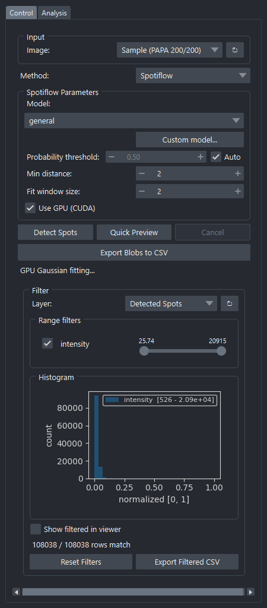
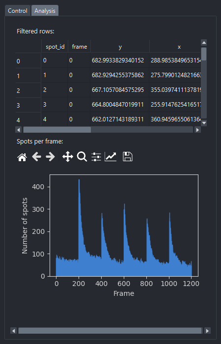

# Spot Detection

Detects spots in 2D images or `(T, Y, X)` stacks, with two backends:

- **Spotiflow** — pretrained CNN models for fluorescent spot detection
- **LoG** — classical Laplacian-of-Gaussian blob detection (fallback)

Optionally fits a 2D Gaussian to each spot and emits a per-spot Labels layer
with region properties (area, intensity, FWHM, solidity, …) ready for
filtering.

**Source:** [`_detection_widget.py`](https://github.com/) — class
`DetectionWidget`.

The widget has two tabs: **Control** (parameters and detection) and
**Analysis** (filtered table + spots-per-frame plot).

---

## Control tab

{ width=440 }

### Input

| Field | Notes |
|---|---|
| **Image** | Image layer to detect on. Refresh button re-scans layers. |

### Method

| Field | Notes |
|---|---|
| **Method** | `Spotiflow` or `LoG`. The panel below switches accordingly. |

### Spotiflow Parameters

| Field | Notes |
|---|---|
| **Model** | One of the bundled pretrained models (`general`, `synth_complex`, `hybiss`, `fluo_live`, …). |
| **Custom model…** | Browse to a Spotiflow model directory on disk. |
| **Probability threshold** | Spots below this confidence are dropped. |
| **Auto** | Check to let Spotiflow pick the threshold automatically. |
| **Min distance** | Minimum pixel separation between detections (NMS). |
| **Fit window size** | Half-size of window used for refining sub-pixel position. |
| **Use GPU (CUDA)** | Run inference on GPU if available. |

### LoG Parameters

| Field | Notes |
|---|---|
| **Min sigma** / **Max sigma** | Range of Gaussian scales searched. |
| **Num sigma** | Number of scales between min and max. |
| **Threshold** | Minimum LoG response to keep a spot. |

### Mask Generation

Turns each detected point into a per-spot mask with a fitted Gaussian.

| Field | Notes |
|---|---|
| **Generate mask during detection** | Run mask fitting as part of the main *Detect Spots* button. |
| **Fitting backend** | `scipy` (CPU, parallel) or `torchimize` (batched GPU via CUDA; listed only when installed). |
| **Points layer** | Existing Points layer to generate masks from (instead of re-detecting). |
| **Generate Mask from Points** | Run mask generation on the chosen Points layer. |
| **Cancel** | Stops the mask worker. |

### Action buttons

| Button | Notes |
|---|---|
| **Detect Spots** | Run detection on every frame. |
| **Quick Preview** | Run on the current time point only — fast iteration on parameters. |
| **Cancel** | Stop the running detection. |
| **Export Blobs to CSV** | Save the per-spot table (positions + properties). |

### Filter panel

The Filter sub-panel lets you hide spots by any numeric property — area,
mean intensity, FWHM-X, FWHM-Y, solidity, etc. Each property gets a range
slider with a small histogram. Filtering is non-destructive — only the
visible subset is hidden; the underlying Points layer still holds all data.

The **Show filtered in viewer** toggle controls whether the napari Points
layer mirrors the filter.

---

## Analysis tab

{ width=440 }

The Analysis tab shows the currently-filtered spots as:

- A **table** of rows.
- A **bar chart of spots per frame** with the matplotlib navigation toolbar
  (zoom, pan, save).

---

## Outputs

| Output | Type |
|---|---|
| **Detected Spots** | napari **Points** layer with per-spot region properties attached as features. |
| **Spot Masks** | napari **Labels** layer (only when mask generation runs). |
| CSV export | Wide table of every spot (frame, y, x, area, intensity, perimeter, solidity, FWHM_x, FWHM_y, …). |
