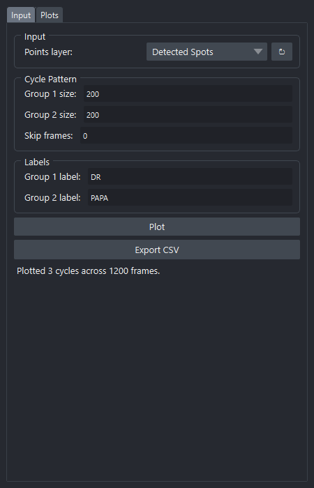
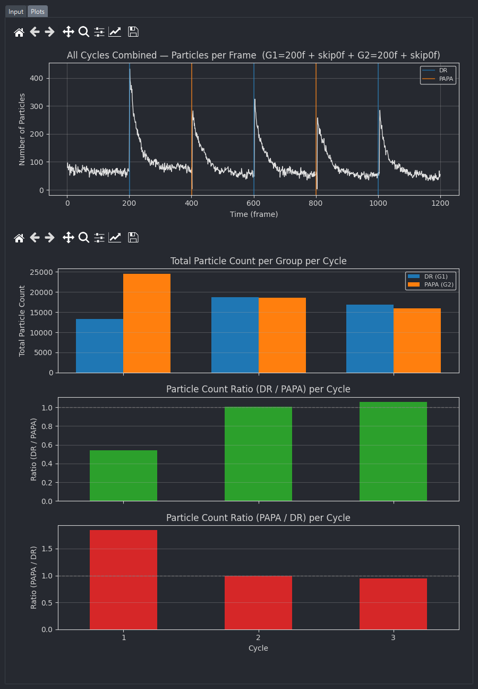

# PAPA

For **cyclical / alternating** experiments where frames belong to one of two
recurring groups (e.g. *DR* vs *PAPA* illumination). The widget groups your
detected spots by cycle pattern and produces per-cycle counts and ratios.

**Source:** [`_papa_widget.py`](https://github.com/) — class `PAPAWidget`.

The widget has two tabs: **Input** (configuration) and **Plots** (results).

---

## Input tab

{ width=440 }

### Input

| Field | Notes |
|---|---|
| **Points layer** | Detected spots (must have `frame`, `y`, `x`). Usually the output of *Spot Detection*. |

### Cycle Pattern

!!! warning "Changed 2026-07-30"

    Output produced before this date paired each group-2 readout with the
    group-1 readout **preceding** it, and clipped a trailing incomplete cycle
    instead of dropping it. Per-cycle CSVs and ratio graphs from before and
    after this change are **not comparable** — the cycle numbering and column
    names are identical, so the files cannot be told apart by inspection.

Define how frames repeat. The **first `Group 1 size` frames are a lead-in** —
readout that precedes the first reactivation pulse — and belong to no cycle.
Cycle 1 starts at the block after that, so a cycle runs
`G2 → (skip) → G1 → (skip)`: each group-2 readout is paired with the group-1
readout that **follows** it.

| Field | Notes |
|---|---|
| **Group 1 size** | Number of frames in group 1 per cycle. Also the length of the excluded lead-in. |
| **Group 2 size** | Number of frames in group 2 per cycle. |
| **Skip frames** | Number of frames between blocks that are excluded from both groups (e.g. shutter / settling frames). This is the pulse that starts a cycle. |

Group identity follows the block alternation from frame 1 and never moves: a
`Group 1 size`-length block is always group 1, a `Group 2 size`-length block
always group 2. No block is ever re-sliced.

The stack must be at least
`Group 1 size + Skip + Group 2 size + Skip + Group 1 size` frames long — the
excluded lead-in plus one cycle — with `G1=10, G2=10, Skip=2` that is 34.
**Incomplete cycles are not reported:** both of a cycle's blocks must fit
entirely within the stack, so a trailing block with no partner is dropped
rather than truncated. If no complete cycle fits, the status bar says so and
names the frame count required.

### Labels

| Field | Notes |
|---|---|
| **Group 1 label** | Default `DR`. Used in plot legends and CSV column names. |
| **Group 2 label** | Default `PAPA`. |

### Action buttons

| Button | Notes |
|---|---|
| **Plot** | Compute the cycle annotations and switch to the **Plots** tab. |
| **Export CSV** | Save the annotated per-frame and per-cycle DataFrames as CSV. |

---

## Plots tab

{ width=440 }

Four stacked figures, each with the matplotlib navigation toolbar:

1. **Particles per frame** — line plot of detected particle count over the
   entire experiment. The excluded lead-in is shaded grey, and a colored
   vertical line marks the end of every group block — both mid-cycle and at
   cycle boundaries, so the lines don't single out cycle boundaries. The
   trace covers every frame, so lead-in and skip data stay visible even though
   they belong to no cycle. The headless script's equivalent figure
   (`scripts/papa_analysis.py`) additionally shades each group's frame range
   with a colored background band and marks cycle boundaries with a dotted
   separator.
2. **Total counts per group per cycle** — bar chart, G1 and G2 side-by-side
   for every cycle.
3. **G1 / G2 ratio** per cycle.
4. **G2 / G1 ratio** per cycle.

---

## Outputs

| Output | Type |
|---|---|
| **CSV export** | `papa_per_frame.csv` — one row per frame with `frame`, `n_particles`, `cycle`, `group`; lead-in and skip frames carry an empty `cycle`/`group`. `papa_per_cycle.csv` — one row per complete cycle with per-group counts and both ratios. |

PAPA does **not** add any new napari layers — it's a pure analysis widget.
