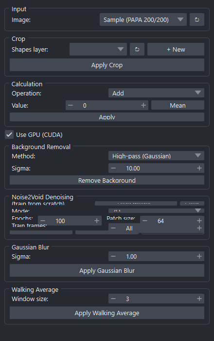

# Pre-Processing

Prepares raw microscopy stacks for detection: cropping, arithmetic,
background removal, denoising, blurring, and temporal averaging. Each
operation produces a new Image layer in napari so you can compare and roll
back freely.

{ width=440 }

**Source:** [`_cleanup_widget.py`](https://github.com/) — class
`PreProcessingWidget`.

---

## Input

| Field | Notes |
|---|---|
| **Image** | Image layer to operate on. Works on 2D arrays and 3D `(T, Y, X)` stacks. |

The refresh button next to the dropdown re-scans napari layers.

## Crop

Crop the stack to a rectangle defined by a Shapes layer.

| Field | Notes |
|---|---|
| **Shapes layer** | Existing Shapes layer with a rectangle, or use **+ New** to add an empty one and draw on it. |
| **Apply Crop** | Crops every frame to the bounding box of the first rectangle. |

## Calculation

Add or subtract a constant from every pixel.

| Field | Notes |
|---|---|
| **Operation** | `Add` or `Subtract` |
| **Value** | Constant to add/subtract |
| **Mean** | Auto-fill *Value* with the stack mean (useful for "subtract background mean") |
| **Apply** | Run the operation |

## Background Removal

Suppress slowly-varying background structure.

| Field | Notes |
|---|---|
| **Method** | `High-pass (Gaussian)` — subtract a wide Gaussian-blurred copy; or `Erosion (Morphological)` — subtract a morphological opening. |
| **Sigma** *(high-pass)* | Standard deviation in pixels of the Gaussian kernel used to estimate background. |
| **Disk size** *(erosion)* | Radius of the structuring element. |
| **Use GPU (CUDA)** | Run on GPU when available (top-level toggle that also affects N2V). |
| **Remove Background** | Apply the chosen method to every frame. |

!!! tip
    *High-pass Gaussian* is fast and works well for diffuse fluorescence
    background. *Erosion* handles structured background (cells, edges) better
    but is slower.

## Noise2Void Denoising

Self-supervised denoising. Either train a new model from the current stack or
load an existing one.

| Field | Notes |
|---|---|
| **Load model… / Clear** | Browse to a saved N2V model directory, or clear to retrain. |
| **Mode** | `2D` (frame-by-frame) or `3D` (treat T as a real dimension). |
| **Epochs** | Training epochs (only used if no model loaded). |
| **Patch size** | Training patch size in pixels. |
| **Train frames** | Subset of frames to train on (`All` or a count). |
| **Denoise (N2V)** | Train (if needed) and denoise the full stack. |
| **Quick Preview** | Apply only to the current time point. |
| **Cancel** | Stops an in-progress N2V run. |

N2V runs in a background worker — a napari progress bar appears at the bottom
of the window, and the rest of the UI stays responsive.

## Gaussian Blur

| Field | Notes |
|---|---|
| **Sigma** | Standard deviation in pixels. |
| **Apply Gaussian Blur** | Per-frame 2D Gaussian blur. |

## Walking Average

Sliding-window mean across time.

| Field | Notes |
|---|---|
| **Window size** | Number of frames averaged per output frame. |
| **Apply Walking Average** | Produces a new stack with reduced noise but reduced temporal resolution. |

---

## Outputs

Each operation creates a new Image layer with a suffix describing what was
applied — for example:

- `MyStack (crop)`
- `MyStack (-12.3)` (Calculation: subtract 12.3)
- `MyStack (hp s=10)` (high-pass Gaussian, σ = 10)
- `MyStack (erode r=5)`
- `MyStack (N2V denoised)`
- `MyStack (blur s=1)`
- `MyStack (avg w=3)`

The chain of suffixes acts as a record of how the stack was processed.
