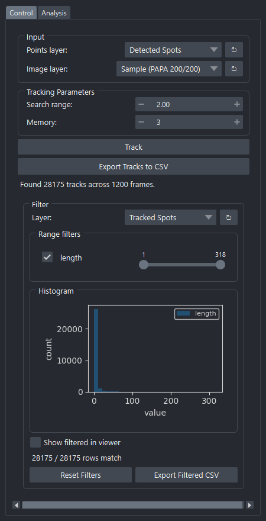
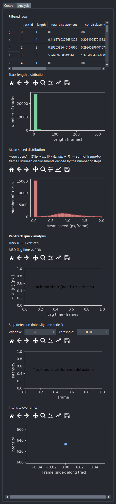

# Spot Tracking

Links detected spots across time into tracks using
[`trackpy`](http://soft-matter.github.io/trackpy/), then exposes per-track
analytics:

- **MSD** (mean squared displacement) with anomalous-diffusion fit `D · t^α`
- **Step detection** with adjustable window and threshold
- **Intensity over time** (sampled from a chosen Image layer)

**Source:** [`_tracking_widget.py`](https://github.com/) — class
`TrackingWidget`.

The widget has two tabs: **Control** (link spots into tracks) and **Analysis**
(filtering + per-track plots).

---

## Control tab

{ width=440 }

### Input

| Field | Notes |
|---|---|
| **Points layer** | The output of *Spot Detection* (must have `frame`, `y`, `x`). |
| **Image layer** *(optional)* | Source for per-vertex intensity sampling along each track. |

### Tracking Parameters

| Field | Notes |
|---|---|
| **Search range** | Maximum pixel jump a particle is allowed to make between consecutive frames. |
| **Memory** | Number of frames a particle is allowed to disappear before its track is broken. |

### Action buttons

| Button | Notes |
|---|---|
| **Track** | Link spots into tracks. Creates a Tracks layer. |
| **Export Tracks to CSV** | Save the full per-vertex DataFrame (one row per `(track_id, frame)`). |

### Filter panel

Filter tracks by any per-track property — `length`, `mean_speed`,
`mean_intensity`, etc. Same UI as the Detection widget; range-slider per
property with a histogram preview. The viewer Tracks layer can mirror the
filter via **Show filtered in viewer**.

---

## Analysis tab

{ width=440 }

### Filtered rows

A table of the tracks currently passing the filter. **Click a row** to drive
the per-track plots below.

### Distributions

- **Track length distribution** — histogram of how long each track survives.
- **Mean speed distribution** — histogram with the formula label
  `mean_speed = (Σ ||pᵢ − pᵢ₋₁||) / (length − 1)`.

### Per-track quick analysis

For the selected row:

- **MSD** chart with an anomalous-diffusion fit overlay
  `MSD(t) = 4·D·t^α`. Failure to fit (e.g. too few points) is handled
  gracefully.
- **Step detection** chart — sliding-window mean step size; controls for
  *Window* and *Threshold* re-plot live.
- **Intensity over time** chart — sampled from the chosen Image layer at each
  track vertex.

Each plot ships with the matplotlib navigation toolbar (zoom / pan / save).

---

## Outputs

| Output | Type |
|---|---|
| **Tracked Spots** | napari **Tracks** layer. Per-track properties (`length`, `mean_speed`, etc.) are attached as features; the underlying DataFrame is stored in `metadata["tracked_df"]`. |
| CSV export | Per-vertex DataFrame — one row per `(track_id, frame)` with position, frame, and (if image provided) intensity. |
